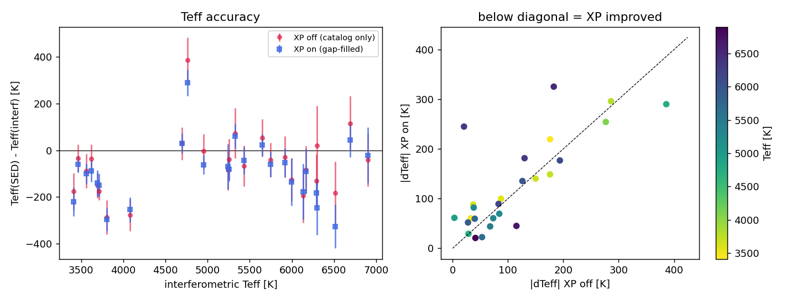

# Data sources & spectro-photometry

**ARIADNE** builds the broadband SED automatically from catalog photometry and
*gap-fills* it with synthetic photometry derived from public spectroscopic and
spectro-photometric surveys. The sources, their roles, and how to opt out of
each are documented below (pulled from the README so the two never drift):

```{include} ../README.md
:start-after: <!-- DOC:DATASOURCES-START -->
:end-before: <!-- DOC:DATASOURCES-END -->
```

(validating-the-fills)=
## Validating the fills

The synthetic optical fills were validated against **28 stars with directly
measured (interferometric) effective temperatures** from the CHARA array
(Boyajian et al. 2012, 2013), spanning F through M. Each star was fit twice —
with the Gaia XP fills in (`spectra = True`) and without them
(`spectra = False`) — using wide, uninformative `Teff` and `[Fe/H]` priors so
the *photometry*, not a prior, drives the result.



The fills add 6–10 genuine optical bands per star (Strömgren, Cousins, SDSS,
Pan-STARRS) — real gaps even for these bright, well-observed benchmarks. The
result:

- **Precision.** The recovered `Teff` posterior is **~35 % tighter with the
  fills** (mean σ 58 K vs 88 K; 19 of 20 stars improve). This is the robust,
  reproducible gain — the error bars in the left panel shrink uniformly.
- **Accuracy.** The fills introduce only a small (~30 K, within the sample
  scatter) cool shift; the SED `Teff` tracks the interferometric `Teff` with or
  without them.
- **Enabling fits.** Sparsely-observed stars that have too few catalog bands to
  fit at all become fittable once the fills are in (e.g. Barnard's Star, which
  has ≤ 5 usable catalog bands on its own).

The benchmark stars are the *best-observed* in the sky, so this measures the
fills where they have the least to add; on the sparsely-observed stars the
fills actually target, the gain is larger.
