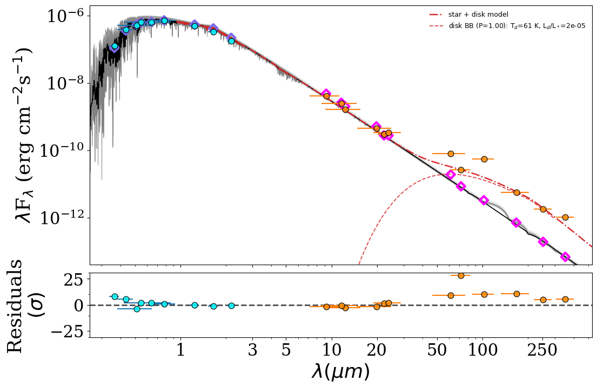
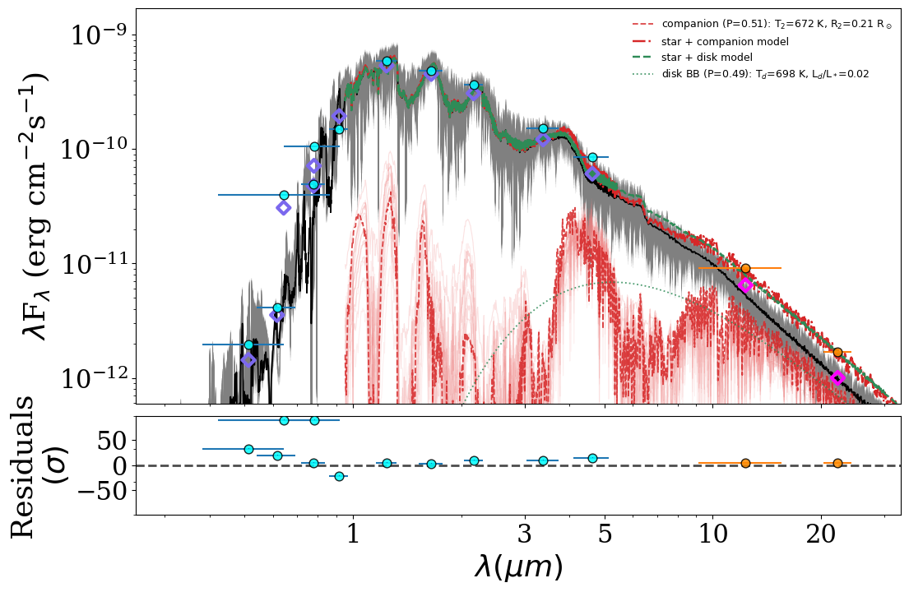

# Infrared excess (IRX)

**ARIADNE** quantifies and characterizes infrared excess — debris disks and
unresolved cool companions — as a *post-fit* analysis layered on top of the
photosphere fit. The guiding design rule:

> **IR-excess bands never constrain the photosphere.** Bands redward of
> ~5 µm are excluded from the fit (they would bias `Teff`/radius on exactly
> the stars of interest) and are instead compared against the
> posterior-predictive photosphere after the fit converges.

The result is a fully Bayesian excess characterization: per-band excess
significances, an evidence-based classification among four hypotheses
(no excess / single-temperature disk / two-temperature disk / unresolved cool
companion), and physical parameters for the winning model — all written into
the standard output pickle and rendered by a dedicated SED + excess figure.

## Band routing

The excess set is `config.irx_bands` — every supported band redward of
~5 µm (Spitzer IRAC 5.8/8.0, AKARI IRC 9/18 and FIS 65/90/140/160, IRAS
12/25/60/100, WISE W3/W4, Spitzer MIPS 24/70/160, Herschel PACS 70/100/160
and SPIRE 250/350/500). Routing is automatic:

- `Star.add_mag(mag, err, band)` sends any `irx_bands` member to the star's
  excess set instead of the fit set.
- The librarian does the same for every IR band it retrieves.

The routing is always on (excess bands never pollute the fit), but the
excess *analysis* runs only in the dedicated `fit_irx()` endpoint -- see the
Quick example below.

## Far-IR catalogs (automatic)

The librarian retrieves the mid/far-IR photometry itself, including the
flux-density (Jy-native) catalogs:

| Catalog | Bands | Epoch | Notes |
|---|---|---|---|
| AllWISE | W3, W4 | 2010.6 | Vega mags, `qph` QC |
| AKARI IRC PSC | 9, 18 µm | 2006.5 | Jy; `q=3` only |
| AKARI FIS BSC | 65, 90, 140, 160 µm | 2006.5 | Jy; `q=3` only; large beam |
| IRAS PSC | 12, 25, 60, 100 µm | **1983.5** | Jy; percent errors; `q≥2` (rejects upper limits) |
| Herschel PACS PSC | 70, 100, 160 µm | ~2011 | mJy; edge/blend/SNR QC |
| Herschel SPIRE PSC | 250, 350, 500 µm | ~2011 | mJy; extended sources kept (disks!) |
| Spitzer SEIP | IRAC + MIPS 24 | ~2007 | via IRSA TAP; saturation QC |

All positional lookups are **proper-motion propagated** to each catalog's
mean epoch using the Gaia astrometry — essential for nearby stars (a
1″/yr star sits >30″ from its IRAS position). The 2MASS/WISE crossmatch
falls back to a PM-propagated cone when the Gaia `best_neighbour` tables
have no entry (common for high-PM stars).

## Reach gating

Excess is *quantified* only on bands that every in-play model grid actually
reaches: a single-grid fit uses that grid's spectral reach; a BMA fit uses
the **intersection** of the ensemble grids' reaches (further limited by each
grid's reliability cutoff, `config.grid_wave_coverage`). Bands beyond the
common reach are still shown on the SED but carry no model prediction
(`quantified = False`, "plot-only").

## Quantification

For each quantified band the posterior-predictive photosphere flux (and its
uncertainty) is computed by drawing from the fit posterior — for BMA,
across grids by their evidence weights. The per-band significance is

```
sigma = (F_obs - F_phot) / sqrt(err_obs^2 + err_phot^2)
```

Bands at `sigma >= 3` are flagged significant; the summary aggregates them
into `excess_chi2`, `n_significant` and the `has_excess` flag.

## Classification: four hypotheses, one evidence comparison

The excess fluxes are compared under four models via direct quadrature of
the Bayesian evidence (exact at these low dimensionalities — no sampling
noise):

1. **Null** — no excess (zero-parameter baseline; Occam's anchor).
2. **Disk** — a single-temperature **modified blackbody**
   (`B_λ × (210 µm/λ)` beyond 210 µm, the standard grain-emission
   convention), with log-uniform priors on `T ∈ [30, 1500] K` and
   `L_dust/L_* ∈ [1e-7, 1e-1]`.
3. **Two-temperature disk** — warm + cold modified blackbodies
   (`T_warm > T_cold`), activated when ≥5 bands are quantified; the
   evidence comparison absorbs the Occam penalty for the two extra
   parameters.
4. **Companion** — an unresolved cool photosphere with free `Teff2` and
   `R2`, evaluated as a **BMA over the cool-capable model grids**
   (cool-extended BT-Settl to 400 K, ATMO 2020 to 200 K, Sonora Bobcat to
   200 K with [Fe/H]), at the primary's `[M/H]`, `d` and `A_V`. The
   reported `Teff2`/`R2` carry both the within-grid posterior width and the
   across-grid model disagreement.

Two physical constraints make the disk-vs-companion comparison meaningful:

- **The `L_max(T)` prior.** Disk fractional luminosity is capped by an
  empirical envelope: `1e-1` up to 500 K (extreme, giant-impact debris
  disks) declining log-linearly to `1e-4` at 1500 K (the hot-exozodi
  ceiling). Without it, a luminous companion photosphere can masquerade as
  an astrophysically impossible hot, ultra-luminous "disk".
- **The fit-band consistency penalty.** Both excess models pay
  `Σ (c_b/σ_b)²` for any flux `c_b` they predict in the *fit* bands (the
  photosphere fit converged there, so excess flux would have appeared as
  residuals); `σ_b` is the fitted, noise-inflated error budget. This stops
  a companion constrained only at W3/W4 from wandering to near-IR-bright
  solutions.

The posterior model probabilities (`P(none)`, `P(disk)`, `P(disk2)`,
`P(companion)`) classify the excess as `none` / `disk` / `companion` /
`ambiguous` (the latter when neither disk-total nor companion exceeds 75%
of their joint probability).

## Output

`out['irx']` holds one dict per excess band (`wave, obs, obs_err, model,
model_err, excess, sigma, quantified`) plus `out['irx']['_summary']`:

| Key | Meaning |
|---|---|
| `quantified`, `plot_only`, `significant` | band lists |
| `has_excess`, `n_significant`, `excess_chi2` | aggregate detection stats |
| `excess_class` | `none` / `disk` / `companion` / `ambiguous` |
| `p_none`, `p_disk`, `p_disk2`, `p_companion` | posterior model probabilities |
| `disk` | quadrature posterior: `t_dust ± err`, `l_dust_over_lstar ± err`, `omega_sr` |
| `disk2` | two-T posterior: `t_warm/t_cold`, `l_warm/l_cold` (+ `_map` best-fit values used for display) |
| `disk_bb` | least-squares modified-BB fit to the measured excess (the curve that threads the data) |
| `companion` | BMA `teff2 ± err`, `rad2 ± err`, `n_grids`, and `per_grid` posteriors (with correlated `(Teff2, R2)` samples) |
| `lnbf_disk_companion` | log Bayes factor, disk-total vs companion |
| `common_reach_um` | reddest quantified wavelength |
| `degraded` | `None`, or the explicit reason characterization is unavailable (e.g. norm mode: no physical distance) |

## Plotting

The standard SED figure is untouched. The excess view is a separate method:

```python
artist = SEDPlotter(in_file, plots_out_folder, ir_excess=True)
artist.plot_SED()   # the classic SED figure, fit bands only (unchanged)
artist.IRX_SED()    # SED + IR-excess: IRX_SED.png/pdf
```

`IRX_SED` renders the photosphere (with gray posterior draws), the excess
photometry, and the winning excess model: the star+disk curve for a disk
(both components shown for a decisive two-T solution), or the actual cool
photosphere spectrum at the BMA `(Teff2, R2)` for a companion — drawn at
spectral resolution from the spectra cache, with light-red correlated
posterior draws mirroring the photosphere's gray ones. An ambiguous excess
shows *both* candidate models, each labeled with its probability. Residuals
use the reported per-band significances (photosphere uncertainty included).

The companion spectra ship inside the standard spectra cache
(`spectra_cache.h5`, groups `btsettl_cool` / `atmo` / `sonora`); without the
cache the companion curve degrades to band-resolution.

## Quick example

IR excess is characterized **only** by the dedicated ``fit_irx()`` endpoint —
the default ``fit_bma()`` / ``fit_single()`` / ``fit_binary()`` endpoints
never run it. On every ``fit_irx`` call the **W2 block** (≥ 4.4 µm: WISE W2,
IRAC 4.5, SPHEREX 4650/4900) is routed into the quantified-excess set — that
is the peak of a cool companion's SED, and leaving it in the fit lets the
photosphere absorb exactly the signal ``fit_irx`` exists to quantify. The
photosphere stays anchored through 4.4 µm (W1, IRAC 3.6, SPHEREx ≤ 4300). In
the regular SED endpoints W2 remains an ordinary **fit** band. An **opt-in**
flag, ``fit_irx(route_mid_ir=True)``, widens the routing to the full
2.75–5 µm block (W1/W2, IRAC 3.6/4.5, SPHEREx 2750–4900), so the excess set
carries the W1–W2 CH₄ color as companion-vs-disk evidence — maximal shape
leverage, but every band beyond 2.4 µm is then judged against an
extrapolated baseline, and any tilt (corrupted photometry, model NIR
systematics) turns into high-significance pseudo-excess. Enable it only when
the ≤ 2.4 µm photosphere is demonstrably clean (e.g. XP + SPHEREx NIR
anchored). ``fit_irx`` auto-selects the deep-IR ensemble: it finds the
deepest IR reach any suitable grid achieves and keeps every grid achieving
it, so the common (intersection) reach is clipped as little as possible.
Passing ``models=[...]`` overrides the selection and is respected in full —
but a grid with no IR-excess capability (phoenix, coelho, koester) raises
immediately rather than silently clipping the quantified set to nothing.

```python
from astroARIADNE.star import Star
from astroARIADNE.fitter import Fitter
from astroARIADNE.plotter import SEDPlotter

s = Star('epsEri', 53.2283, -9.4582, g_id=5164707970261890560)
# WISE W3/W4, AKARI, IRAS, PACS, SPIRE are fetched and routed automatically.

f = Fitter()
f.star = s
f.setup = ['dynesty', 500, 0.1, 'multi', 'rwalk', 6, False]
f.av_law = 'fitzpatrick'
f.out_folder = 'epsEri'
f.prior_setup = {'teff': 'default', 'logg': 'default', 'z': 'default',
                 'dist': 'default', 'rad': 'default', 'Av': 'default'}
# (Av auto-pins to 0 for d < 70 pc unless you set an explicit Av prior.)
f.fit_irx()        # one call: auto-ensemble + BMA fit + IRX characterization

artist = SEDPlotter('epsEri/BMA.pkl', 'epsEri/plots', ir_excess=True)
artist.plot_SED()
artist.IRX_SED()

import pickle
irx = pickle.load(open('epsEri/btsettl_out.pkl', 'rb'))['irx']['_summary']
print(irx['excess_class'], irx['disk'])
```

Running exactly this (it ships as
[`examples/irx_disk.py`](https://github.com/jvines/astroARIADNE/blob/master/examples/irx_disk.py))
quantifies twelve excess bands out to SPIRE 350 µm and classifies eps Eri as
a **disk** at T_dust = 62 ± 3 K — right on the literature 60–65 K — with the
companion hypothesis rejected at lnBF ≈ 430:



The companion case looks qualitatively different — here SCR 1845 (an M8.5
with a T6 brown-dwarf companion,
[`examples/irx_companion.py`](https://github.com/jvines/astroARIADNE/blob/master/examples/irx_companion.py)):
the excess is warm (W3/W4), and the overlay draws the actual cool-photosphere
spectrum at the recovered (Teff2, R2) rather than a blackbody. With only two
excess bands the disk and companion hypotheses come out near-even, so both
are shown with their probabilities:



## Validation set

| Star | Truth (literature) | ARIADNE IRX result |
|---|---|---|
| eps Eri | cold disk ~60 K | disk, `T = 66 K`, P = 1.00 |
| HD 10647 (q1 Eri) | cold disk | disk, `T = 63 K`, P = 1.00 |
| GJ 581 | cold disk ~50 K (Lestrade+12, Herschel) | disk, `T = 50 K`, P = 1.00 |
| SCR 1845-6357 | T6 companion, ~950 K (Avenhaus+12) | companion, `Teff2 = 895 K`, P = 0.91 |

## Caveats

- **Two bands cannot do everything.** With only W3/W4 the disk/companion
  discrimination leans heavily on the priors; classifications get decisive
  as the band count grows.
- **A bright companion belongs in binary mode.** The IRX companion model is
  a post-fit characterization; when a companion is decisive *and*
  contributes to the fit bands, the rigorous answer is ARIADNE's joint
  two-component fit (SB2 mode).
- **Far-IR beams are large.** IRAS (up to ~2′) and AKARI FIS sit in cirrus;
  a far-IR "detection" can be confusion. The catalog quality cuts reject
  upper limits, but treat isolated single-band far-IR excesses skeptically.
- **Late-M photospheres at W4.** Model W4 fluxes for late-M dwarfs carry
  percent-level systematics; few-σ W4-only excesses around M dwarfs deserve
  caution.
