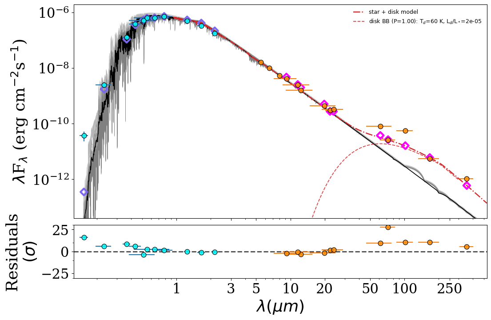
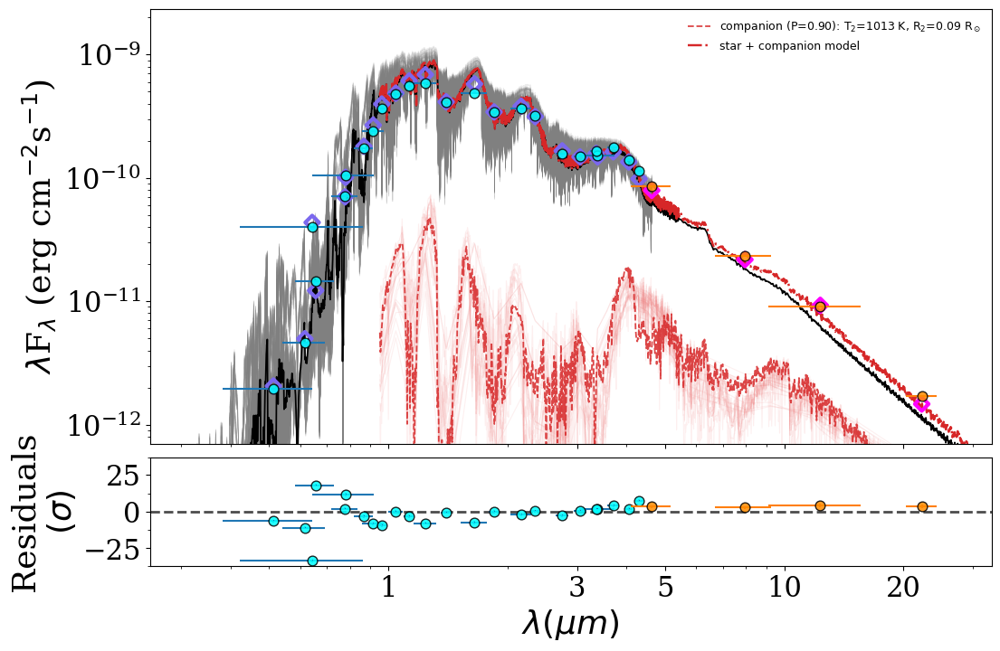

# Infrared excess (IRX)

**ARIADNE** quantifies and characterizes infrared excess — debris disks and
unresolved cool companions — as a *post-fit* analysis layered on top of the
photosphere fit. The guiding design rule:

> **IR-excess bands never constrain the photosphere.** Bands redward of
> ~5 µm are excluded from the fit (they would bias `Teff`/radius on exactly
> the stars of interest) and are instead compared against the
> posterior-predictive photosphere after the fit converges.

The result is a fully Bayesian excess characterization: per-band excess
significances, an evidence-based classification among four hypotheses
(no excess / single-temperature disk / two-temperature disk / unresolved cool
companion), and physical parameters for the winning model — all written into
the standard output pickle and rendered by a dedicated SED + excess figure.

## Band routing

The excess set is `config.irx_bands` — every supported band redward of
~5 µm (Spitzer IRAC 5.8/8.0, AKARI IRC 9/18 and FIS 65/90/140/160, IRAS
12/25/60/100, WISE W3/W4, Spitzer MIPS 24/70/160, Herschel PACS 70/100/160
and SPIRE 250/350/500). Routing is automatic:

- `Star.add_mag(mag, err, band)` sends any `irx_bands` member to the star's
  excess set instead of the fit set.
- The librarian does the same for every IR band it retrieves.

The routing is always on (excess bands never pollute the fit), but the
excess *analysis* runs only in the dedicated `fit_irx()` endpoint -- see the
Quick example below.

## Far-IR catalogs (automatic)

The librarian retrieves the mid/far-IR photometry itself, including the
flux-density (Jy-native) catalogs:

| Catalog | Bands | Epoch | Notes |
|---|---|---|---|
| AllWISE | W3, W4 | 2010.6 | Vega mags, `qph` QC |
| AKARI IRC PSC | 9, 18 µm | 2006.5 | Jy; `q=3` only |
| AKARI FIS BSC | 65, 90, 140, 160 µm | 2006.5 | Jy; `q=3` only; large beam |
| IRAS PSC | 12, 25, 60, 100 µm | **1983.5** | Jy; percent errors; `q≥2` (rejects upper limits) |
| Herschel PACS PSC | 70, 100, 160 µm | ~2011 | mJy; edge/blend/SNR QC |
| Herschel SPIRE PSC | 250, 350, 500 µm | ~2011 | mJy; extended sources kept (disks!) |
| Spitzer SEIP | IRAC + MIPS 24 | ~2007 | via IRSA TAP; saturation QC |

All positional lookups are **proper-motion propagated** to each catalog's
mean epoch using the Gaia astrometry — essential for nearby stars (a
1″/yr star sits >30″ from its IRAS position). The 2MASS/WISE crossmatch
falls back to a PM-propagated cone when the Gaia `best_neighbour` tables
have no entry (common for high-PM stars).

## Reach gating

Excess is *quantified* only on bands that every in-play model grid actually
reaches: a single-grid fit uses that grid's spectral reach; a BMA fit uses
the **intersection** of the ensemble grids' reaches (further limited by each
grid's reliability cutoff, `config.grid_wave_coverage`). Bands beyond the
common reach are still shown on the SED but carry no model prediction
(`quantified = False`, "plot-only").

## Quantification

For each quantified band the posterior-predictive photosphere flux (and its
uncertainty) is computed by drawing from the fit posterior — for BMA,
across grids by their evidence weights. The per-band significance is

```
sigma = (F_obs - F_phot) / sqrt(err_obs^2 + err_phot^2)
```

Bands at `sigma >= 3` are flagged significant; the summary aggregates them
into `excess_chi2`, `n_significant` and the `has_excess` flag. The same
per-band variance enters every hypothesis' likelihood in the evidence
comparison below.

### Error budget

The per-band variance is

```
err_obs^2  = err_cat^2 + (c_b * F_obs)^2 + err_conf^2
err_phot^2 = max(var_pp, sum_g w_g var_g + mean_g (mu_g - F_phot)^2)
```

- `err_cat` is the catalogue error.
- `c_b` is the **absolute calibration uncertainty of the survey** that
  measured band `b`. Catalogue errors omit it, and it is multiplicative on
  the measured flux:

  | Survey | `c_b` | Source |
  |---|---|---|
  | WISE W1/W2/W3/W4 | 2.4 / 2.8 / 4.5 / 5.7% | Jarrett et al. 2011 |
  | Spitzer IRAC (all channels) | 3% | Reach et al. 2005 |
  | Spitzer MIPS 24/70/160 | 2 / 5 / 12% | Engelbracht+2007, Gordon+2007, Stansberry+2007 |
  | Spitzer IRS (CASSIS bands) | 5% | IRS Instrument Handbook v5.0, Sect. 9.3 |
  | AKARI IRC 9/18 µm | 3 / 4% | Ishihara et al. 2010 |
  | AKARI FIS N60/WIDE-S/WIDE-L/N160 | 20 / 20 / 30 / 40% | Kawada et al. 2007 |
  | IRAS 12/25/60/100 µm | 3.6 / 5.8 / 5.8 / 10.4% | IRAS Explanatory Supplement VI.C.2.c: 2/5/5/10% relative to the 12 µm reference, which is itself 3%, combined in quadrature |
  | Herschel PACS 70/100/160 | 5% | Balog et al. 2014 |
  | Herschel SPIRE 250/350/500 | 5.5% | Bendo et al. 2013 |
  | SPHEREx ≤ 3.82 µm / 3.82–5 µm | 1.4 / 2.2% | SPHEREx Explanatory Supplement v2.0 (2026-08-25) Sect. 4.2.1: ~1% CALSPEC scale + <1% per channel; bands 5–6 rest on 1–6 standards with 2–4% model systematics, so 2% common there |
  | any other band | 2% | the former generic floor |

  **Correlation between bands (default `'covariant'` budget).** Bands of
  one instrument share its absolute scale, so `c_b` is split into a common
  term `a_b`, fully correlated across the instrument's bands, and an
  independent band-to-band term `r_b`, with `c_b^2 = a_b^2 + r_b^2`. Two
  bands `b ≠ b'` of one instrument have covariance `a_b a_b' F_b F_b'`.
  Where the source documents the split it is used: IRAS 3% common (the
  12 µm reference scale) + 2/5/5/10%; SPIRE 4% common (Neptune model) +
  1.5% per band, combined in quadrature (4.3%) rather than linearly as in
  the 5.5% above; SPHEREx 1% common (2% in detector bands 5–6) + 1% per
  channel. No other instrument documents an inter-band correlation. Their
  bands are tied to one set of standard-star (or planet/asteroid) models,
  so the smallest `c_b` among an instrument's bands is taken as the common
  scale and the rest as independent: IRAC, IRS and PACS are fully
  correlated (3, 5, 5%); WISE has 2.4% common and 0/1.4/3.8/5.2%
  independent for W1–W4; MIPS has 2% common; AKARI IRC 3%; FIS 20%. Bands
  of an unknown instrument are independent.

  The evidence then uses the full covariance matrix `C`: every excess-band
  χ² is `rᵀ C⁻¹ r` and the profiled primary amplitude of the cool-host joint
  fit is the matching generalised least-squares solution. `log det C` does
  not depend on the hypothesis and cancels, so the quadrature evidences
  stay exact. The per-band significances use the marginal (diagonal)
  errors. A common offset of one instrument's whole scale is now mostly
  absorbed. Independent errors would read it as a coherent excess in all of
  that instrument's bands. The photosphere-model and confusion terms stay
  diagonal.
- `err_conf` is the far-IR extragalactic confusion noise (unchanged).
- `err_phot` is the **photosphere model uncertainty**. `var_pp` is the
  variance of the BMA posterior-predictive draws, i.e. the within-grid
  scatter plus the evidence-weighted scatter between grids. The grid
  evidences are set by the optical and near-IR fit bands and carry no
  information on how well each grid's atmosphere physics works at 10–500 µm.
  When the weight collapses onto one grid, `var_pp` drops the other grids'
  disagreement at exactly the wavelengths where it was never tested. The
  default budget therefore replaces the between-grid term with the
  **equal-weight** spread of the grids' mean predictions `mu_g` about the
  reported BMA flux, keeps the evidence-weighted within-grid term `var_g`,
  and never goes below `var_pp`. A single-grid fit has no between-grid term.
  The empirical WISE baseline correction and its error are applied on top,
  as before.

Three budgets are available through `Fitter.irx_error_budget` or
`fit_irx(error_budget=...)`:

- `'covariant'` (default): the terms above with the instrument-level
  calibration covariance.
- `'independent'`: the same terms, with each band's total `c_b` treated as
  independent (a diagonal covariance).
- `'legacy'`: reproduces the earlier budget exactly: the catalogue error floored at 2% of the flux (`max(err_cat,
0.02 F_obs)`) and `err_phot^2 = var_pp`. The budget used is recorded as
`out['irx']['_summary']['error_budget']`. Each band also stores
`model_err_pp` (the posterior-predictive part), `model_err_grid` (the
equal-weight inter-grid spread) and `cal_frac`.

### Injection model for injection–recovery tests

`astroARIADNE.fitter.companion_injection_flux(names, wave, teff2, rad2,
dist_pc, model='sonora')` returns the band fluxes of a companion to inject.
Recovering BT-Settl injections with BT-NextGen, BT-Cond and BT-Dusty, plus
the BT-Settl fit grid, is circular, because all of them share the PHOENIX
code, opacities and cloud treatment. Injections therefore default to
**Sonora Bobcat** (Marley et al. 2021). The shipped Sonora cube is Bobcat
only (200–2400 K, log g 3–5.5, [M/H] −0.5 to +0.5). Diamondback and Elf Owl
are not in the grid cache. Above 2400 K the injection falls back to **ATMO
2020** (Phillips et al. 2020, to 3000 K), the most independent non-BT model
that reaches late-M temperatures. So companions injected at 2400–2600 K come
from ATMO, and the recorded `model_used` says so. `model='btsettl'`
reproduces the old injections. Sonora and ATMO are each one of the five
companion recovery grids. For a fully held-out test, set
`Fitter.irx_companion_grids` to the recovery grids minus the injection grid
(the IRX_experiment drivers do this with `IRX_INJ_HOLDOUT=1`).

## Classification: four hypotheses, one evidence comparison

The excess fluxes are compared under four models via direct quadrature of
the Bayesian evidence (exact at these low dimensionalities — no sampling
noise):

1. **Null** — no excess (zero-parameter baseline; Occam's anchor).
2. **Disk** — a single-temperature **modified blackbody**
   (`B_λ × (210 µm/λ)` beyond 210 µm, the standard grain-emission
   convention), with log-uniform priors on `T ∈ [30, 1500] K` and
   `L_dust/L_* ∈ [1e-7, 1e-1]`.
3. **Two-temperature disk** — warm + cold modified blackbodies
   (`T_warm > T_cold`), activated when ≥5 bands are quantified; the
   evidence comparison absorbs the Occam penalty for the two extra
   parameters.
4. **Companion** — an unresolved cool photosphere with free `Teff2` and
   `R2`, evaluated as a **BMA over the cool-capable model grids**
   (cool-extended BT-Settl to 400 K, ATMO 2020 to 200 K, Sonora Bobcat to
   200 K with [Fe/H]), at the primary's `[M/H]`, `d` and `A_V`. The
   reported `Teff2`/`R2` carry both the within-grid posterior width and the
   across-grid model disagreement.

Two physical constraints make the disk-vs-companion comparison meaningful:

- **The `L_max(T)` prior.** Disk fractional luminosity is capped by an
  empirical envelope: `1e-1` up to 500 K (extreme, giant-impact debris
  disks) declining log-linearly to `1e-4` at 1500 K (the hot-exozodi
  ceiling). Without it, a luminous companion photosphere can masquerade as
  an astrophysically impossible hot, ultra-luminous "disk".
- **The fit-band consistency penalty.** Both excess models pay
  `Σ (c_b/σ_b)²` for any flux `c_b` they predict in the *fit* bands (the
  photosphere fit converged there, so excess flux would have appeared as
  residuals); `σ_b` is the fitted, noise-inflated error budget. This stops
  a companion constrained only at W3/W4 from wandering to near-IR-bright
  solutions.

### Companion prior from Gaia astrometry

A second, near-twin photosphere can reshape the mid-IR as well as weak dust
can, and the photometry alone does not separate them. Gaia does: a stellar
companion of light ratio `q = L2/L1` moves the photocentre by
`α = a |B − β| / d` (`B` the mass fraction from the Mamajek main-sequence
masses, `β = q/(1+q)`), and makes the system `log10(1+q)` dex overluminous for
its Teff. `Fitter.irx_companion_prior = 'astrometric'` (the default) weights
every companion node by the likelihood of the observed diagnostics under that
companion, relative to none:

- **Astrometric term**: `ε + (1−ε)(1 − f_det)`, with `f_det` the probability
  that Gaia DR3 would have shown the wobble: separations from the Raghavan et
  al. (2010) period distribution, restricted to unresolved pairs
  (`a < 1″ × d`); orbits slower than the 34-month baseline leave only their
  curvature; a wobble is detected when it exceeds `σ_AL √(2(r² − 1))`,
  `r = max(RUWE, 1.4)`, so an elevated RUWE allows a companion up to the
  wobble it implies. Stellar companions only (Teff2 inside the Mamajek mass
  column); a substellar companion's mass is age-degenerate. Off when RUWE is
  unknown or Gaia flags the star as non-single (`non_single_star > 0`).
  `ε = 1 − astrometric_reliability` (0.01) bounds the suppression.
- **Overluminosity term**: a Gaussian comparison of the fitted
  `log L − log L_MS(Teff)` with `log10(1+q)`, width 0.1 dex combined with the
  Teff error (2% floor) times the local slope of the sequence; capped at 1.
- **Hosts off the main sequence**: the overluminosity term assumes a
  main-sequence primary. A companion fainter than its primary adds at most
  `log10(2) = 0.30` dex, so a system further above the sequence than that is
  there by its evolutionary state (a pre-main-sequence star, 0.5-1.5 dex above
  the sequence for an M dwarf of 1-20 Myr, or an evolved one), and its
  overluminosity says nothing about a companion. For such a host the reference
  is its own isochrone: along a pre-main-sequence isochrone the cooler star is
  the further above the main sequence, so a coeval stellar companion satisfies
  `log q ≥ log L_MS(Teff2) − log L_MS(Teff1)`, and a companion fainter than
  that is penalised (one-sided Gaussian, width from the main-sequence width
  and both Teff errors). The two terms are mixed by the probability that the
  host is off the sequence, `p_off = Φ((Δ − log10 2)/σ − offms_gate_sigma)`
  with `offms_gate_sigma = 2.5`: below 1e-4 on the sequence, 0.02 for GJ 876,
  above 0.8 at 1.2 dex. `_summary['companion_prior']['p_off_main_sequence']`
  records it.

The weight is never above 1: astrometry can veto a companion, never vote for
one. The companion is also strictly fainter than the primary bolometrically
(`q < 1`). The star's `ruwe`, `astrometric_excess_noise_sig` and
`non_single_star` come from the Gaia archive lookup and round-trip through
`Star.to_nc`. The excess-noise significance is ignored by default: for bright
stars in DR3 it is dominated by attitude and calibration noise. Every constant
is in `IRX_COMPANION_PRIOR_SETTINGS` and can be overridden through
`Fitter.irx_companion_prior_settings`; `irx_companion_prior = 'legacy'`
removes the weight. `_summary['companion_prior']` records the state used.

### One distance for the radius, the luminosity and the excess

The SED fixes the angular radius `R/d`. The photosphere fit samples `R` and
`d` separately, with the parallax distance as the prior on `d`, and where the
parallax is poor its `(R, d)` can sit far along that degeneracy from the
catalogue distance (Gaia DR3 6244258239317113088, RUWE 5.7: fitted at 55-80 pc
against 113 pc). The excess hypotheses are evaluated at the catalogue distance
(`star.dist`), with the primary's radius and luminosity moved there,
`R → R d_cat/d_fit`, `L → L (d_cat/d_fit)²` (`Fitter._irx_frame`). The dust
fractional luminosity, the companion radius bounds and the overluminosity of
the companion prior then all refer to one distance. `_summary` records
`distance_scale`, `rad_primary` and `lum_primary`.

The default distance prior is the Bailer-Jones distance with its own
uncertainty, `N(dist, dist_e)` truncated at zero (it was `3 dist_e` until
2026-11-24, which let the fit drift along `R/d`).

### Dust ceiling of a young host

The dust prior ends at `L_dust/L_* = 0.1` below 500 K, falling to `1e-4` at
1500 K: the range of debris disks and hot exozodiacal dust. A primordial disk
is more luminous. A flat passive disk intercepts a quarter of the stellar
luminosity, flaring and accretion raise that, and its inner rim re-emits about
a tenth of `L_*` near the sublimation temperature. For a host the companion
prior puts off the main sequence (`p_off_main_sequence >= 0.5`) the ceiling is
`1` below 500 K, falling log-linearly to `0.1` at 1500 K. `_summary` records
`young_host`.

The companion radius bound and the `composite` / `unresolved` labels of compact
primaries are decided by the fitted radius (`compact_primary` in `_summary`),
not by the radius at the catalogue distance: a main-sequence fit railed at the
0.05 Rsun radius floor can fall below it there.

### Bands the re-fitted primary cannot model

For cool hosts (below 4000 K) the null, disk and companion are scored against
a primary re-fitted to all bands with the top-weight grid. Where that grid has
no finite flux (BT-Settl has none in the Spitzer IRS synthetic bands at M-dwarf
temperatures), `irx_primary_fill = 'model'` (default) uses the model-averaged
photosphere the excess was measured against. The earlier behaviour, `'zero'`,
set the primary's flux there to 0, so the null missed the whole observed IRS
flux and a near-twin companion or hot dust won by supplying it.
`irx_companion_prior = 'legacy'` with `irx_primary_fill = 'zero'` reproduces
the cal_run4 (2026-11-22) results.

The posterior model probabilities (`P(none)`, `P(disk)`, `P(disk2)`,
`P(companion)`) classify the excess as `none` / `disk` / `companion` /
`ambiguous` (the latter when neither disk-total nor companion exceeds 75%
of their joint probability).

## Output

`out['irx']` holds one dict per excess band (`wave, obs, obs_err, model,
model_err, excess, sigma, quantified`) plus `out['irx']['_summary']`:

| Key | Meaning |
|---|---|
| `quantified`, `plot_only`, `significant` | band lists |
| `has_excess`, `n_significant`, `excess_chi2` | aggregate detection stats |
| `excess_class` | `none` / `disk` / `companion` / `ambiguous` |
| `p_none`, `p_disk`, `p_disk2`, `p_companion` | posterior model probabilities |
| `disk` | quadrature posterior: `t_dust ± err`, `l_dust_over_lstar ± err`, `omega_sr` (means, skewed by the log-uniform prior) and the **reported summaries**, posterior medians with 68% intervals: `t_dust_med/_lo/_hi`, `l_dust_over_lstar_med/_lo/_hi`, and `omega_med_sr` (the solid angle at the medians) |
| `disk2` | two-T posterior: `t_warm/t_cold`, `l_warm/l_cold` (means), `t_*_med/_lo/_hi`, `l_*_med/_lo/_hi`, `omega_*_med`, `l_dust_over_lstar_med/_lo/_hi` (the pair's total; the posterior medians `IRX_SED` prints and draws) and the `_map` best-fit values |
| `disk_bb` | least-squares modified-BB fit to the measured excess (a diagnostic; not what the figure draws) |
| `companion` | BMA `teff2 ± err`, `rad2 ± err`, `n_grids`, and `per_grid` posteriors (with correlated `(Teff2, R2)` samples) |
| `lnbf_disk_companion` | log Bayes factor, disk-total vs companion |
| `common_reach_um` | reddest quantified wavelength |
| `degraded` | `None`, or the explicit reason characterization is unavailable (e.g. norm mode: no physical distance) |

## Plotting

The standard SED figure is untouched. The excess view is a separate method:

```python
artist = SEDPlotter(in_file, plots_out_folder, ir_excess=True)
artist.plot_SED()   # the classic SED figure, fit bands only (unchanged)
artist.IRX_SED()    # SED + IR-excess: IRX_SED.png/pdf
```

`IRX_SED` renders the photosphere (with gray posterior draws), the excess
photometry, and the winning excess model: the star+disk curve for a disk
(both components shown for a decisive two-T solution), or the actual cool
photosphere spectrum at the BMA `(Teff2, R2)` for a companion — drawn at
spectral resolution from the spectra cache, with light-red correlated
posterior draws mirroring the photosphere's gray ones. An ambiguous excess
shows *both* candidate models, each labeled with its probability. Residuals
use the reported per-band significances (photosphere uncertainty included).
The dust curve is evaluated at the posterior medians of the disk parameters, and the legend prints them (`T_d` and `L_d/L_*`, or the warm and cold temperatures of a two-T disk), so the figure agrees with the reported `disk` / `disk2` summaries.

The companion spectra ship inside the standard spectra cache
(`spectra_cache.h5`, groups `btsettl_cool` / `atmo` / `sonora`); without the
cache the companion curve degrades to band-resolution.

## Quick example

IR excess is characterized **only** by the dedicated ``fit_irx()`` endpoint —
the default ``fit_bma()`` / ``fit_single()`` / ``fit_binary()`` endpoints
never run it. On every ``fit_irx`` call the **W2 block** (≥ 4.4 µm: WISE W2,
IRAC 4.5, SPHEREX 4650/4900) is routed into the quantified-excess set — that
is the peak of a cool companion's SED, and leaving it in the fit lets the
photosphere absorb exactly the signal ``fit_irx`` exists to quantify. The
photosphere stays anchored through 4.4 µm (W1, IRAC 3.6, SPHEREx ≤ 4300). In
the regular SED endpoints W2 remains an ordinary **fit** band. An **opt-in**
flag, ``fit_irx(route_mid_ir=True)``, widens the routing to the full
2.75–5 µm block (W1/W2, IRAC 3.6/4.5, SPHEREx 2750–4900), so the excess set
carries the W1–W2 CH₄ color as companion-vs-disk evidence — maximal shape
leverage, but every band beyond 2.4 µm is then judged against an
extrapolated baseline, and any tilt (corrupted photometry, model NIR
systematics) turns into high-significance pseudo-excess. Enable it only when
the ≤ 2.4 µm photosphere is demonstrably clean (e.g. XP + SPHEREx NIR
anchored). ``fit_irx`` auto-selects the deep-IR ensemble: it finds the
deepest IR reach any suitable grid achieves and keeps every grid achieving
it, so the common (intersection) reach is clipped as little as possible.
Passing ``models=[...]`` overrides the selection and is respected in full —
but a grid with no IR-excess capability (phoenix, coelho, koester) raises
immediately rather than silently clipping the quantified set to nothing.

```python
from astroARIADNE.star import Star
from astroARIADNE.fitter import Fitter
from astroARIADNE.plotter import SEDPlotter

s = Star('epsEri', 53.2283, -9.4582, g_id=5164707970261890560)
# WISE W3/W4, AKARI, IRAS, PACS, SPIRE are fetched and routed automatically.

f = Fitter()
f.star = s
f.setup = ['dynesty', 500, 0.1, 'multi', 'rwalk', 6, False]
f.av_law = 'fitzpatrick'
f.out_folder = 'epsEri'
f.prior_setup = {'teff': 'default', 'logg': 'default', 'z': 'default',
                 'dist': 'default', 'rad': 'default', 'Av': 'default'}
# (Av auto-pins to 0 for d < 70 pc unless you set an explicit Av prior.)
f.fit_irx()        # one call: auto-ensemble + BMA fit + IRX characterization

artist = SEDPlotter('epsEri/BMA.pkl', 'epsEri/plots', ir_excess=True)
artist.plot_SED()
artist.IRX_SED()

import pickle
irx = pickle.load(open('epsEri/btsettl_out.pkl', 'rb'))['irx']['_summary']
print(irx['excess_class'], irx['disk'])
```

Running exactly this (it ships as
[`examples/irx_disk.py`](https://github.com/jvines/astroARIADNE/blob/master/examples/irx_disk.py))
quantifies twelve excess bands out to SPIRE 350 µm and classifies eps Eri as
a **disk** at T_dust = 62 ± 3 K — right on the literature 60–65 K — with the
companion hypothesis rejected at lnBF ≈ 430:



The companion case looks qualitatively different — here SCR 1845 (an M8.5
with a T6 brown-dwarf companion,
[`examples/irx_companion.py`](https://github.com/jvines/astroARIADNE/blob/master/examples/irx_companion.py)):
the excess is warm (W3/W4), and the overlay draws the actual cool-photosphere
spectrum at the recovered (Teff2, R2) rather than a blackbody. With only two
excess bands the disk and companion hypotheses come out near-even, so both
are shown with their probabilities:



## Validation set

| Star | Truth (literature) | ARIADNE IRX result |
|---|---|---|
| eps Eri | cold disk ~60 K | disk, `T = 66 K`, P = 1.00 |
| HD 10647 (q1 Eri) | cold disk | disk, `T = 63 K`, P = 1.00 |
| GJ 581 | cold disk ~50 K (Lestrade+12, Herschel) | disk, `T = 50 K`, P = 1.00 |
| SCR 1845-6357 | T6 companion, ~950 K (Avenhaus+12) | companion, `Teff2 = 895 K`, P = 0.91 |

## Caveats

- **Two bands cannot do everything.** With only W3/W4 the disk/companion
  discrimination leans heavily on the priors; classifications get decisive
  as the band count grows.
- **A bright companion belongs in binary mode.** The IRX companion model is
  a post-fit characterization; when a companion is decisive *and*
  contributes to the fit bands, the rigorous answer is ARIADNE's joint
  two-component fit (SB2 mode).
- **Far-IR beams are large.** IRAS (up to ~2′) and AKARI FIS sit in cirrus;
  a far-IR "detection" can be confusion. The catalog quality cuts reject
  upper limits, but treat isolated single-band far-IR excesses skeptically.
- **Late-M photospheres at W4.** Model W4 fluxes for late-M dwarfs carry
  percent-level systematics; few-σ W4-only excesses around M dwarfs deserve
  caution.
